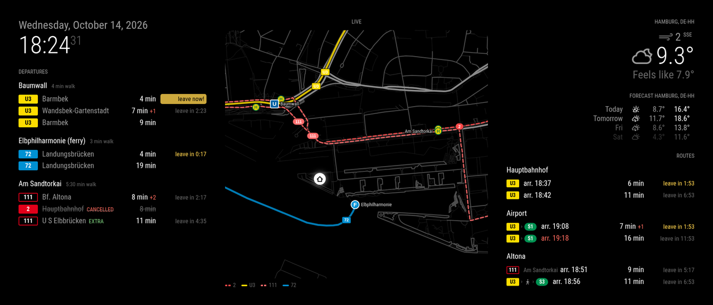
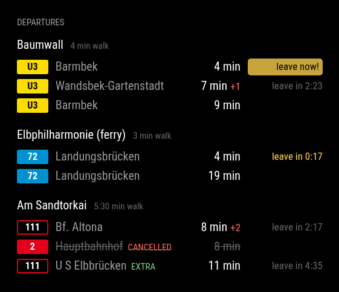
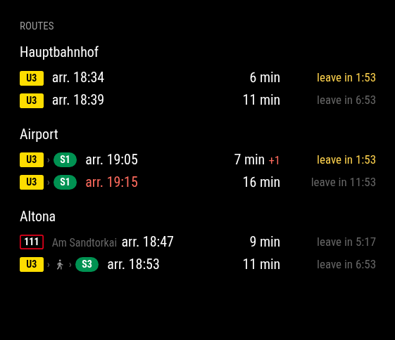
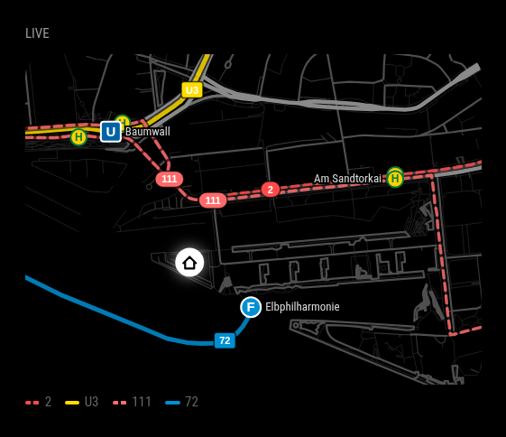

# MMM-HVV

Hamburg public transport (HVV) for [MagicMirror²](https://magicmirror.builders/) – departures,
routes and a live map, built on the official HVV Geofox API.



**Three views** – each is its own module instance, so you can place, size and enable them independently:

| Departures | Routes | Live map |
|---|---|---|
|  |  |  |
| Several stations, line and direction filters, real-time delays, cancellations, and a **"leave in 2:15" countdown** based on your walking time | Connections to your destinations incl. transfers (`U3 › S1`), only the ones that actually make the connection, only in the time windows you choose | Minimal street map around your home with your lines, stops at their real (also temporarily relocated) position and **live vehicles** |

Further highlights: light on the API (≈ 1 request per minute for all stations), no external
dependencies, German and English, scales with your mirror's font size.

---

- [Requirements](#requirements)
- [Installation](#installation)
- [Find your stations](#find-your-stations)
- [Departures view](#departures-view)
- [Routes view](#routes-view)
- [Map view](#map-view)
- [Keeping the password secret](#keeping-the-password-secret)
- [API usage](#api-usage)
- [Logging and troubleshooting](#logging-and-troubleshooting)
- [Development](#development)
- [Feedback & contributions](#feedback--contributions)

## Requirements

- MagicMirror² ≥ 2.30, Node.js ≥ 20
- Access to the HVV **Geofox Thin Interface (GTI)**. It's free for private use – request it at
  [hvv.de › Datenabruf](https://www.hvv.de/de/fahrplaene/abruf-fahrplaninfos/datenabruf)
  (contact details at the bottom of the page). You'll receive a **user name** and a **password**
  (called `apiKey` below).

## Installation

```bash
cd ~/MagicMirror/modules
git clone https://github.com/FlorianSpanuth/MMM-HVV.git
```

No `npm install` needed – the module only uses what Node.js ships with.

Update with `git pull` in the module folder.

## Find your stations

The module needs station IDs. The included script finds them and lists the lines and directions
that serve the station:

```bash
cd ~/MagicMirror/modules/MMM-HVV
HVV_API_USER=<user> HVV_API_KEY=<password> node scripts/find-station.js "Baumwall"
```

```
Matches:
  Master:11907     Baumwall (Elbphilharmonie), Hamburg  [bus, u]

Lines and directions at Baumwall (Elbphilharmonie):
  2     → Hauptbahnhof | ZOB | U S Berliner Tor (Beim Strohhause) | Schenefeld, Stadtzentrum | …
  111   → U S Elbbrücken (Baakenwerder Straße) | Bf. Altona
  U3    → Hauptbahnhof Süd - Barmbek | Rödingsmarkt - Wandsbek-Gartenstadt | Landungsbrücken - Saarlandstraße | …

Config snippet (keep only the lines you need, add a direction to narrow it down):
  { id: "Master:11907", name: "Baumwall (Elbphilharmonie)", walkTime: "5:00", lines: ["2", "17", "111", "607", "U3"] },
```

## Departures view


```js
{
	module: "MMM-HVV",
	position: "top_left",
	header: "Departures",
	config: {
		apiUser: "your-user",
		apiKey: "${SECRET_HVV_API_KEY}", // see "Keeping the password secret"
		stations: [
			{ id: "Master:11907", name: "Baumwall", walkTime: "4:00", lines: ["U3"] },
			{ id: "Master:80932", name: "Elbphilharmonie (ferry)", walkTime: "3:00", lines: ["72"] },
			{
				id: "Master:11040",
				name: "Am Sandtorkai",
				walkTime: "5:30",
				lines: [
					{ line: "111", direction: "Altona" }, // only buses whose destination contains "Altona"
					"2" // all directions
				]
			}
		],
		buffer: 60 // seconds you want to be at the stop before departure
	}
}
```

### How the leave time works

For each departure: `leave = departure (incl. real-time delay) − walking time − buffer`.

- `leave in 4:12` – plenty of time (grey); turns **yellow** within `leaveSoon` seconds
- `leave now!` – the buffer has started; you still make it if you go now
- once you couldn't make it even without the buffer, the departure disappears (`hideUnreachable`)

There's one countdown per connection (line + direction), so two directions leaving shortly after
each other each get their own. Real-time data from the GTI has minute precision.

### Options

| Option | Default | Description |
|---|---|---|
| `apiUser`, `apiKey` | – | GTI credentials (**required**) |
| `stations` | `[]` | Stations, see below (**required**) |
| `departuresPerStation` | `3` | Rows per station |
| `maxTimeOffset` | `60` | Minutes ahead to look for departures |
| `buffer` | `30` | Seconds of tolerance at the stop |
| `hideUnreachable` | `true` | Hide departures you can no longer reach on foot |
| `leaveTimeFor` | `"connection"` | Countdown for the next departure per `"connection"` (line + direction), per `"station"`, or for `"all"` |
| `leaveSoon` | `120` | Seconds before leaving when the countdown turns yellow |
| `timeFormat` | `"relative"` | `"relative"` (5 min), `"absolute"` (12:34) or `"both"` |
| `showDelay` | `true` | Show delays (+2) |
| `showPlatform` | `false` | Always show the platform (changed platforms are always shown) |
| `showLineType` | `true` | Colored line badges |
| `showRelocations` | `false` | Orange dot on departures from a temporarily relocated stop (needs `lines` per station) |
| `showAnnouncements` | `true` | Service announcements (construction work, disruptions) below the list |
| `announcementScope` | `"stations"` | `"stations"`: only those mentioning your stations · `"lines"`: everything on your lines |
| `maxAnnouncements` | `2` | Maximum announcements shown |
| `updateInterval` | `60` | Seconds between departure requests |
| `quietHours` | `{ from: "01:00", to: "05:00", interval: 900 }` | Poll less often at night; `null` to disable |

### Station options

| Option | Description |
|---|---|
| `id` | Station ID from `find-station.js` |
| `name` | Display name |
| `walkTime` | Walking time to the stop: `"5:30"` (min:sec), `5.5` (minutes) or `"90s"`. Omit to disable the countdown for this station |
| `lines` | Lines to show; omit for all. Each entry is a line name (`"U3"`) or `{ line, direction, walkTime }`: `direction` is matched against the destination (case-insensitive, part of the name is enough, may be a list); `walkTime` overrides the station's walking time for this line (e.g. another platform or entrance) |

## Routes view


Connections from a station to your destinations. Each row: the lines you ride as colored badges
(`U3 › S1`, a walking figure for walks between stops), arrival, departure and the leave countdown.

```js
{
	module: "MMM-HVV",
	position: "top_right",
	header: "Routes",
	config: {
		view: "routes",
		apiUser: "your-user",
		apiKey: "${SECRET_HVV_API_KEY}",
		buffer: 60,
		routes: [
			{ name: "Hauptbahnhof", from: "Master:11907", to: "Hauptbahnhof", walkTime: "4:00" },
			{ name: "Airport", from: "Master:11907", to: "Hamburg Airport", walkTime: "4:00", when: { days: "mon-fri", from: "06:00", to: "10:00" } },
			{ name: "Altona", from: "Master:11907", to: "Altona", walkTime: { default: "4:00", 111: "5:30" } }
		]
	}
}
```

**Only useful connections:** the GTI router only returns connections whose transfers work. On top of
that, connections beaten by a later one are dropped – a train that misses its connection arrives
together with the next one, so only the later train is shown.

| Route option | Description |
|---|---|
| `name` | Display name (default: `to`) |
| `from`, `to` | Station ID (`"Master:11907"`) or station name (`"Hamburg Airport"`, looked up once a day) |
| `walkTime` | Walking time to `from`: `"4:00"`, or per first line `{ default: "4:00", 111: "5:30" }` |
| `when` | Time window(s) in which the route is calculated, e.g. `{ days: "mon-fri", from: "07:00", to: "09:30" }` or a list of those. `days`: `"mon-fri"`, `"sat,sun"`, `"weekend"`, `"daily"`, `["mon", "wed"]`. Omit for always |
| `options` | Connections shown per route (default `2`) |

View options: `buffer`, `hideUnreachable`, `showDelay`, `showLineType`, `quietHours`,
`routeInterval` (default `120` s, used when a departure is less than 20 min away) and
`routeIntervalFar` (default `300` s). No requests are made outside the time windows; while no route
is active the module sends the notification `MM2_CONTENT { hasContent: false }`, so a visibility
manager can hide it.

## Map view


```js
{
	module: "MMM-HVV",
	position: "bottom_left",
	header: "Live",
	config: {
		view: "map",
		apiUser: "your-user",
		apiKey: "${SECRET_HVV_API_KEY}",
		home: "Platz der Deutschen Einheit 1", // address, or { lat: 53.5413, lng: 9.9842 }
		stations: [
			{ id: "Master:11907", name: "Baumwall", lines: ["U3"] },
			{ id: "Master:80932", name: "Elbphilharmonie", lines: ["72"] },
			{ id: "Master:11040", name: "Am Sandtorkai", lines: ["2", "111"] }
		],
		height: { portrait: "40vh", landscape: "30vh" }
	}
}
```

Everything is set up automatically on the first start:

1. Your home and the stations are located via the GTI; the map shows the area around them.
2. **Streets** are downloaded once from OpenStreetMap (Overpass API) and cached in
   `~/.cache/mmm-hvv/`. They're drawn as plain grey strokes – no labels, no colors.
3. **Line paths** come from the GTI (the actual course, including current detours). Bus lines are
   drawn per direction and merge into one where both directions use the same street.
4. **Stops** are placed where vehicles actually depart according to the GTI. A temporarily relocated
   stop moves on the map and gets an orange ring (detected from current announcements).
5. **Vehicles** of your lines come from the GTI vehicle map every minute and glide along their
   track. Positions are interpolated between stops from (real-time) schedule data – it's not GPS.

> **No streets on the map?** Downloading the streets can take a few minutes on the first start –
> the public Overpass servers are often busy. Lines, stops and vehicles appear right away; the
> streets follow automatically. If all servers fail, the module retries every 30 minutes. See
> [troubleshooting](#logging-and-troubleshooting).

The map is drawn as SVG in the browser (Web Mercator projection, no map library), fills the width of
its region, re-fits on resize, and its symbols scale with the mirror's font size.

| Option | Default | Description |
|---|---|---|
| `home` | – | Address or `{ lat, lng }` (**required**) – roughly the center of the map |
| `stations` | `[]` | Stations with `lines` – only these lines, their stops and vehicles are shown |
| `height` | `"45vh"` | Any CSS height (`"500px"`, `"40vh"`) or per orientation `{ portrait, landscape }` – try what fits your screen |
| `mapPadding` | `0.3` | Extra space around home and stations |
| `showLegend` | `true` | Line legend below the map |
| `showAttribution` | `false` | "Map © OpenStreetMap" in the legend. **Turn it on if your mirror is shown publicly** – OpenStreetMap data (ODbL) requires attribution then |
| `updateInterval` | `60` | Seconds between vehicle requests |

## Keeping the password secret

MagicMirror² ≥ 2.30 keeps secrets out of `config.js` and away from the browser: put
`SECRET_HVV_API_KEY=<password>` in `config/config.env` and write `"${SECRET_HVV_API_KEY}"` in the
config. Variables starting with `SECRET_` are only resolved on the server.

## API usage

The GTI temporarily blocks accounts averaging more than one request per second. This module stays
far below that:

| What | When | Requests |
|---|---|---|
| Departures for **all** stations (one combined request) | every `updateInterval` (60 s) | 1 |
| Learn station structure (interchange stops, line IDs) | on start, then daily | 1 per station |
| Announcements / relocations | every 10 / 30 minutes (only if used) | 1 |
| Routes: one connection search per active route | every 2–5 minutes, only inside `when` | 1 per route |
| Map: vehicles | every `updateInterval` | 1 |
| Map: setup (locations, line paths) | on start, then daily | ≈ 10 |
| Map: streets (Overpass, not HVV) | once, cached forever | 1 |

No requests while a module is hidden (e.g. by a page switcher), slower polling during
`quietHours`, exponential backoff on errors (up to 15 minutes). Countdowns are computed in the
browser every second without any request.

## Logging and troubleshooting

Like most MagicMirror² modules, MMM-HVV logs through MagicMirror's logger:

- **Server side** (API requests, map setup, errors): wherever your MagicMirror output goes – the
  terminal, `pm2 logs`, or `journalctl` if you run it as a service. Lines are prefixed with
  `[MMM-HVV]`.
- **Browser side** (rendering): the developer console (start with `npm run start:dev`, or open
  `http://<mirror>:8080` in a browser and press F12).

Typical messages and what to do:

| Message / symptom | Meaning |
|---|---|
| `map ready: 7 line paths, 4 bus stops` | Map set up – streets may still be loading |
| `map: 3457 streets from OpenStreetMap cached` | Streets are there |
| `map: Overpass … failed (HTTP 504), trying next` | Overpass server busy – wait, the next server or a later retry will do it |
| `street data unavailable … – map without streets for now` | All Overpass servers failed; retried every 30 min. Check internet access from the mirror |
| `… / Authentication failed!` | Wrong `apiUser` / `apiKey`, access not activated yet, or the `SECRET_…` variable isn't loaded (the `.env` file must be named like the config file: `config.js` → `config.env`) |
| `… A technical problem occured …` (without details) | Temporary problem on the HVV side – the module retries automatically |
| `line "X" not found. Available: …` | A line in `lines` doesn't serve that station – use one of the listed names |
| `station "…" not found` / `address "…" not found` | Check the spelling, or use the ID / `{ lat, lng }` |
| Countdown or times off by hours | The mirror's system time zone isn't Europe/Berlin |

Cache: `~/.cache/mmm-hvv/` (streets, home location). Delete it to force a fresh setup – e.g. after
changing `home` drastically.

## Development

```bash
npm test   # unit tests: time windows, line filters, connection selection, bus line merging
```

## Feedback & contributions

I'd love to hear what you think – reviews, opinions, ideas and bug reports are all very welcome,
just [open an issue](https://github.com/FlorianSpanuth/MMM-HVV/issues). Pull requests are welcome too, whether it's a small fix, a new feature or
better docs.

## Credits

- Inspired by [MMM-HH-LocalTransport](https://github.com/skuethe/MMM-HH-LocalTransport) (MIT)
- Timetable and real-time data: HVV / HBT GmbH, [Geofox Thin Interface](https://gti.geofox.de/)
- Street data: © [OpenStreetMap](https://www.openstreetmap.org/copyright) contributors (ODbL)

## License

MIT
